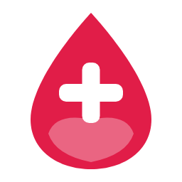

<div id="top"></div>

<div align="center">



# HEMA - Community Blood Donor Network

**Connecting Lifesavers with Those in Critical Need.**  
*Find the Right Donor. Save a Life Today.*

<br />

[](https://hema-blood.vercel.app)
[](https://github.com/TheVicky1/Hema/actions/workflows/ci.yml)
[](LICENSE)
[](https://hacktoberfest.com/)
[](https://github.com/TheVicky1/Hema/issues?q=is%3Aissue+is%3Aopen+label%3A%22good+first+issue%22)
[](https://www.firsttimersonly.com/)
[](docs/CONTRIBUTING.md)
[](https://react.dev/)
[](https://vitejs.dev/)
[](https://reactrouter.com/)
[](https://lucide.dev/)

<br />

> 🌐 **Live Production Deployment**: Experience Hema live in action at **[https://hema-blood.vercel.app](https://hema-blood.vercel.app)**  
> 🩸 **Emergency Blood Network**: Real-time donor matching, live availability status, and one-click contact requests.

<br />

[Live Demo](https://hema-blood.vercel.app) · [About](#about) · [Quick Start](#quick-start) · [Contributing](#contributing) · [Core Features](#core-features) · [Architecture](#architecture) · [Documentation](#documentation)

</div>

---

<div align="center">
  <h2>About</h2>
</div>

Every two seconds, an individual somewhere in the world requires an urgent blood transfusion. Yet critical emergency operations routinely suffer from **fragmented donor databases**, **stale contact records**, and **bureaucratic friction** during the golden hour when every minute counts.

**Blood cannot be manufactured. Human connection is the only cure.**

**HEMA** is an open-source, community-driven **Blood Donor Platform** built with **React 19**, **Vite 7**, **React Router v7**, and **Lucide React** to bridge the critical gap between blood donors and patients facing medical emergencies. Rather than functioning as a passive contact spreadsheet, HEMA delivers an active, real-time coordination system unifying instant blood type filtering, verified location searching, live donor availability status, accessible profile inspections, and friction-free donor requests.

### Foundational Principles

1. **Zero-Friction Emergency Dispatch**: Blood requests are dispatched with a single click without forcing patients or families through mandatory account registrations, paywalls, or complex forms.
2. **Temporal Availability**: Real-time availability badges differentiate between active volunteers ready to donate today and off-duty donors who recently completed a donation cycle.
3. **Privacy-First Data Architecture**: Donor contact credentials remain protected and are only exchanged during an active, confirmed donation coordination workflow.
4. **Minimalist Executive Aesthetic**: An ultra-clean interface pairing a rich crimson brand palette with fluid wave atmospheric backgrounds and WCAG AA accessible contrast.
5. **Open Source & Beginner Friendly**: Designed as a welcoming hub for first-time open-source contributors with modular single-file components, zero-database local setup, and fast-track PR reviews.

---

<div align="center">
  <h2>Quick Start</h2>
</div>

### Prerequisites

- **Node.js**: `v20.x` or higher (LTS recommended)
- **Package Manager**: `npm` (v10+)
- **Git**: Installed and configured

### Local Setup

```bash
# 1. Clone your fork or the repository
git clone https://github.com/TheVicky1/Hema.git
cd Hema

# 2. Install reproducible dependencies
npm install

# 3. Configure local environment variables (if applicable)
cp .env.example .env

# 4. Start local development server
npm run dev
```

Open [http://localhost:5173](http://localhost:5173) in your browser to access HEMA.

### Validation & Quality Gates

Run the verification suite prior to committing changes:

```bash
# Run ESLint quality audit
npm run lint

# Run production build compilation
npm run build

# Run local production preview server
npm run preview
```

---

<div align="center">
  <h2>Contributing</h2>
</div>

Contributions are warmly welcomed! HEMA is designed to be one of the most welcoming, high-impact, and beginner-friendly open-source repositories on GitHub.

> 🚀 **New to Open Source? Start with a Micro-Contribution!**  
> We deliberately scope beginner tasks into **tiny, single-file micro-contributions** (5-30 minutes of work) with exact file pointers, clear acceptance criteria, and step-by-step guidance.  
> 👉 [**Browse Good First Issues**](https://github.com/TheVicky1/Hema/issues?q=is%3Aissue+is%3Aopen+label%3A%22good+first+issue%22) &nbsp;|&nbsp; 📖 [**Read the Contributing Guide**](docs/CONTRIBUTING.md)

### 🌟 Why Contribute to HEMA?

- **⚡ Zero-Database Friction**: Run the full application locally in seconds using mock API providers - no cloud database, Docker containers, or API keys required.
- **🎯 Highly Scoped Micro-Issues**: Tasks touch **one file** (max two) with zero complex backend logic, no migration scripts, and immediate visual feedback.
- **🚀 Fast Maintainer Reviews**: First-time contributor pull requests receive priority review from core maintainers (target turnaround under 48 hours).
- **🏛️ Permanent Recognition**: Every merged contribution is permanently acknowledged in [**CONTRIBUTORS.md**](CONTRIBUTORS.md) and on the [**GitHub Contributors Graph**](https://github.com/TheVicky1/Hema/graphs/contributors).

### ⚡ 8-Step Contributor Quick Start

1. **Pick an Issue**: Browse open [**Good First Issues**](https://github.com/TheVicky1/Hema/issues?q=is%3Aissue+is%3Aopen+label%3A%22good+first+issue%22).
2. **Claim It**: Leave a comment (e.g., *"I would love to work on this issue!"*) so maintainers can assign it to you.
3. **Fork & Clone**: Fork the repository and clone it to your machine (`git clone https://github.com/<your-username>/Hema.git`).
4. **Create a Branch**: Create a descriptive feature branch (`git checkout -b feat/blood-group-filter-pill`).
5. **Make the Change**: Edit the single specified component or style file following the issue instructions.
6. **Verify Locally**: Run `npm run build` to confirm zero compilation errors.
7. **Open a Pull Request**: Push your branch and open a PR linking your issue (e.g., `Closes #12`).
8. **Celebrate & Iterate**: Our maintainers will review your pull request and guide it through to merge!

### For Complete Beginners

Start with our step-by-step [**Beginner's Contribution Guide**](docs/CONTRIBUTING.md) for a comprehensive zero-to-PR walkthrough explaining Git forks, branch setup, making changes, and opening your first pull request.

Explore our curated channels:
- 🎯 [**Live Good First Issues**](https://github.com/TheVicky1/Hema/issues?q=is%3Aissue+is%3Aopen+label%3A%22good+first+issue%22) - Filter active beginner-friendly tasks on GitHub.
- 💬 [**Community Discussions**](https://github.com/TheVicky1/Hema/discussions) - Ask questions, share ideas, and connect with other contributors.

### Not a Beginner?

All contributions are welcome! Whether you are optimizing bundle sizes, enhancing responsive layout breakpoints, improving accessibility, or adding new features:
1. Review the canonical [**CONTRIBUTING.md**](docs/CONTRIBUTING.md) developer guidelines.
2. Ensure your changes adhere to [**Conventional Commits**](docs/GIT_WORKFLOW.md).
3. Validate that all quality gates pass locally before opening a Pull Request.

### Contributor Reference

| Resource | Purpose |
| :--- | :--- |
| 📖 [**Contributing Guide**](docs/CONTRIBUTING.md) | Standard developer workflow, code style, and PR standards |
| 🏗️ [**Architecture Guide**](docs/ARCHITECTURE.md) | React component tree, state patterns, and data flow |
| 🎨 [**Design System**](docs/DESIGN_SYSTEM.md) | Crimson color palette, wave background specs, and tokens |
| 🔧 [**Development Guide**](docs/DEVELOPMENT.md) | Local environment commands, scripts, and build workflows |
| ❓ [**Frequently Asked Questions**](docs/FAQ.md) | Common development and contribution questions |
| 🔒 [**Security Policy**](docs/SECURITY.md) | Responsible disclosure of security vulnerabilities |

---

<div align="center">
  <h2>Core Features</h2>
</div>

HEMA is composed of 12 integrated systems operating under a cohesive, responsive interface:

| System | Capabilities | Status |
| :--- | :--- | :--- |
| **Command Navigation** | 72px vertically centered header, sleek active underline indicator, theme switch, live counter pill, and responsive mobile drawer. | Available |
| **Atmospheric Wave Canvas** | Floating radial crimson ambient orbs, curved SVG boundary waves, and 32px fixed dot-grid canvas texture. | Available |
| **Live Donor Directory** | Real-time multi-criteria filtering by blood group pills (A+, A-, B+, B-, AB+, AB-, O+, O-), city search, and availability. | Available |
| **Interactive Donor Cards** | Initials avatar badges, blood group pills, city tags, live availability status, and quick request action buttons. | Available |
| **Accessible Donor Modal** | Spring-animated dialog with keyboard Escape dismiss, backdrop click close, body scroll-lock, and detailed donor contact credentials. | Available |
| **Live Network Statistics** | Real-time metric strip showcasing total registered donors, available lifesavers, and unique blood group coverage. | Available |
| **Instant Request Dispatch** | One-click emergency contact notification with optimistic state updates and persistent request history tracking. | Available |
| **Donor Registration Workflow** | Self-contained donor registration form with client-side field validation, instant error feedback, and donation benefits column. | Available |
| **Process Walkthrough** | 5-step detailed timeline from initial search to hospital coordination, accompanied by an interactive FAQ accordion. | Available |
| **Toast Notification Bus** | Global auto-dismissing toast notifications for request confirmations, registration success, and system alerts. | Available |
| **Dual Theme System** | Pure white light theme and deep OLED dark theme (`#0C0C0C`) with automatic transition smoothing. | Available |
| **Shimmer Skeleton Loading** | Layout-stable shimmer skeleton cards preventing Cumulative Layout Shift (CLS) during asynchronous data fetching. | Available |

---

<div align="center">
  <h2>Visual Identity & Design Philosophy</h2>
</div>

HEMA features a distinctive luxury visual language designed for clarity, reassurance, and emergency focus:

- **Canvas Foundation**: Pure crisp white (`#FFFFFF`) in light mode and deep OLED Obsidian (`#0C0C0C`, `#161616`) in dark mode eliminating visual fatigue.
- **Rich Crimson Primary**: Brand crimson (`#C9192C` in light mode, `#E02D40` in dark mode) paired with gentle translucent tinted surfaces (`#FEF2F2`, `#2A0810`).
- **Atmospheric Wave Background**: Soft radial gradient orbs (`wave-orb-1`, `wave-orb-2`, `wave-orb-3`) animated with fluid keyframe drifts (`waveFloat1`, `waveFloat2`).
- **Delicate Dot-Grid Texture**: Fixed 32px radial dot matrix on the body canvas providing depth without interface clutter.
- **Custom Scalable SVG Emblem**: Blood drop silhouette, white medical cross, and cupped hand contour rendered without raster artifacts or dark background boxes.

> For complete guidelines, typography scales, and token values, see the [Design System Specification](docs/DESIGN_SYSTEM.md).

---

<div align="center">
  <h2>Architecture</h2>
</div>

HEMA enforces a clean, modular component architecture:

```
+-------------------------------------------------------------+
|                Client Layer (React 19 / UI)                 |
|  - 72px Centered Navbar     - Atmospheric Wave Canvas       |
|  - Active Underline Nav     - Responsive Mobile Drawer      |
+-------------------------------------------------------------+
                               |
                    React Router DOM (v7)
                               |
+-------------------------------------------------------------+
|               Page Modules (src/pages/)                     |
|  - HomePage                 - DonorsPage (Filter Directory) |
|  - BecomeDonorPage          - HowItWorksPage (FAQ Accordion)|
|  - AboutPage (Story/Values) - NotFoundPage (404 Fallback)   |
+-------------------------------------------------------------+
                               |
                   Context & State Layer
                               |
+-------------------------------------------------------------+
|              State Management (src/context/)                |
|  - DonorProvider Context    - Optimistic Request Actions    |
|  - Filter & Search State    - Session Request Persistence   |
+-------------------------------------------------------------+
                               |
                   Mock Data & API Services
                               |
+-------------------------------------------------------------+
|               Data Layer (JSONPlaceholder / Mock)           |
|  - Augmented Donor Profiles - Blood Group Compatibility     |
|  - City Geolocation Mapping - Availability Status Generator |
+-------------------------------------------------------------+
```

> For deep architectural details, see the [Architecture Guide](docs/ARCHITECTURE.md).

---

<div align="center">
  <h2>Project Structure</h2>
</div>

```text
Hema/
├── .github/                   # Workflows (CI pipeline), issue templates, Dependabot config
│   ├── ISSUE_TEMPLATE/        # Standard bug report and feature request templates
│   └── workflows/ci.yml       # Automated GitHub Actions build validation
├── public/                    # Static assets (hema-logo.png, icons)
├── src/
│   ├── assets/                # Static vector assets
│   ├── components/            # Reusable UI component library
│   │   ├── DonorCard.jsx      # Individual donor display card with action buttons
│   │   ├── DonorModal.jsx     # Accessible profile inspection modal dialog
│   │   ├── Footer.jsx         # 4-column responsive footer navigation
│   │   ├── HemaLogo.jsx       # Scalable SVG brand logo with blood drop and cross
│   │   ├── Navbar.jsx         # 72px vertically centered header with active underline
│   │   ├── ScrollToTop.jsx    # Route transition window scroll restoration
│   │   ├── SkeletonCard.jsx   # Shimmer loading placeholder card
│   │   ├── StatsBar.jsx       # 3-column live network metrics display
│   │   ├── ToastContainer.jsx # Global notification toast system
│   │   └── WaveBackground.jsx # Atmospheric floating wave orbs and curved boundaries
│   ├── context/
│   │   └── DonorContext.jsx   # Global donor state provider and dispatch actions
│   ├── pages/
│   │   ├── AboutPage.jsx      # Organization mission, vision, and core values
│   │   ├── BecomeDonorPage.jsx# Donor registration form with client-side validation
│   │   ├── DonorsPage.jsx     # Full donor directory with real-time filters
│   │   ├── HomePage.jsx       # Hero, urgency banner, how-it-works preview, CTA
│   │   ├── HowItWorksPage.jsx # 5-step process timeline and FAQ accordion
│   │   └── NotFoundPage.jsx   # 404 error screen with home navigation link
│   ├── App.css                # Component styles, animations, responsive media queries
│   ├── App.jsx                # React Router root configuration
│   ├── index.css              # Design tokens, color palette, typography, CSS reset
│   └── main.jsx               # React 19 application mount point
├── docs/                      # Comprehensive technical documentation
│   ├── ARCHITECTURE.md        # Technical architecture and data flow
│   ├── CONTRIBUTING.md        # Contributor guidelines and workflow
│   ├── DESIGN_SYSTEM.md       # Color tokens, typography, and styling guide
│   ├── DEVELOPMENT.md         # Local setup and development commands
│   ├── FAQ.md                 # Frequently asked questions
│   └── SECURITY.md            # Security policy and vulnerability reporting
├── index.html                 # HTML shell with Inter font preloading
├── package.json               # Dependencies and build scripts
└── vite.config.js             # Vite 7 build configuration
```

---

<div align="center">
  <h2>Technology Stack</h2>
</div>

- **Frontend Library**: [React 19](https://react.dev/) (Hooks, Context, Modern Concurrent Mode)
- **Build Tool**: [Vite 7](https://vitejs.dev/) (Lightning-fast HMR and optimized Rollup bundling)
- **Routing**: [React Router DOM v7](https://reactrouter.com/) (Declarative Client-Side Routing)
- **Icons**: [Lucide React](https://lucide.dev/) (Clean, consistent SVG iconography)
- **Typography**: [Inter](https://fonts.google.com/specimen/Inter) (Variable font for maximum legibility)
- **Styling**: Native CSS Design Tokens with custom properties (zero CSS-in-JS runtime overhead)
- **Code Quality**: [ESLint 10](https://eslint.org/) with React Hooks & React Refresh plugins

---

<div align="center">
  <h2>Documentation</h2>
</div>

Comprehensive technical specifications and system documentation are maintained in [`docs/`](docs/):

| Document | Purpose |
| :--- | :--- |
| 📖 [**Contributing Guide**](docs/CONTRIBUTING.md) | Standard developer workflow, code style, and PR standards |
| 🏗️ [**Architecture Guide**](docs/ARCHITECTURE.md) | React component tree, state patterns, and data flow |
| 🎨 [**Design System**](docs/DESIGN_SYSTEM.md) | Crimson color palette, wave background specs, and tokens |
| 💻 [**Developer Guide**](docs/DEVELOPMENT.md) | Local environment setup and development commands |
| ❓ [**Frequently Asked Questions**](docs/FAQ.md) | Common development and contribution questions |
| 🔒 [**Security Policy**](docs/SECURITY.md) | Responsible disclosure of security vulnerabilities |

---

<div align="center">
  <h2>Contributors & Community</h2>
</div>

HEMA is built with care by an open-source community dedicated to saving lives through high-craft software engineering.

<div align="center">

[](https://github.com/TheVicky1/Hema/graphs/contributors)

[](https://github.com/TheVicky1/Hema/graphs/contributors)

*A huge thank you to every developer and volunteer who has contributed to the HEMA platform!*

👉 [**View all contributors on GitHub**](https://github.com/TheVicky1/Hema/graphs/contributors)

</div>

---

<div align="center">
  <h2>License</h2>
</div>

HEMA is open-source software licensed under the [MIT License](LICENSE).

---

<div align="center">

**Search. Connect. Save Lives. Repeat.**

[⬆ Back to top](#top)

</div>

<!-- revision: 2026-11-16-7 | docs(readme): add Contrib.rocks dynamic contributor avatar showcase -->
