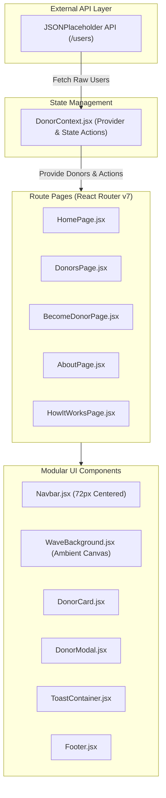

# Architecture & System Design

This document details the software architecture, data flow, component hierarchy, and state management of **Hema**.

---

## Technical Overview

Hema is structured as a client-side Single Page Application (SPA) designed for minimal latency and high availability. It leverages React 19 hooks and context for state management, Vite 7 for build performance, and React Router DOM v7 for declarative routing.

---

## Core Components

| Component | File Path | Primary Responsibility |
| :--- | :--- | :--- |
| **`Navbar`** | [`src/components/Navbar.jsx`](../src/components/Navbar.jsx) | 72px vertically centered header, active underline indicator, theme switch, responsive drawer. |
| **`DonorCard`** | [`src/components/DonorCard.jsx`](../src/components/DonorCard.jsx) | Displays donor name, blood type, city location, availability status, and interactive emergency request action button. |
| **`DonorModal`** | [`src/components/DonorModal.jsx`](../src/components/DonorModal.jsx) | Accessible dialog with keyboard Escape close, backdrop click dismiss, and complete contact details. |
| **`WaveBackground`** | [`src/components/WaveBackground.jsx`](../src/components/WaveBackground.jsx) | Atmospheric floating wave orbs and curved boundary lines for hero and inner pages. |
| **`ToastContainer`** | [`src/components/ToastContainer.jsx`](../src/components/ToastContainer.jsx) | Global notification toast system with auto-dismiss timers. |
| **`Footer`** | [`src/components/Footer.jsx`](../src/components/Footer.jsx) | 4-column responsive footer navigation with platform, company, and resources links. |

---

## Data Model & Transformation

When the application mounts, `DonorContext.jsx` performs an asynchronous HTTP GET request to `https://jsonplaceholder.typicode.com/users` and augments records with blood groups, cities, and live availability flags.
