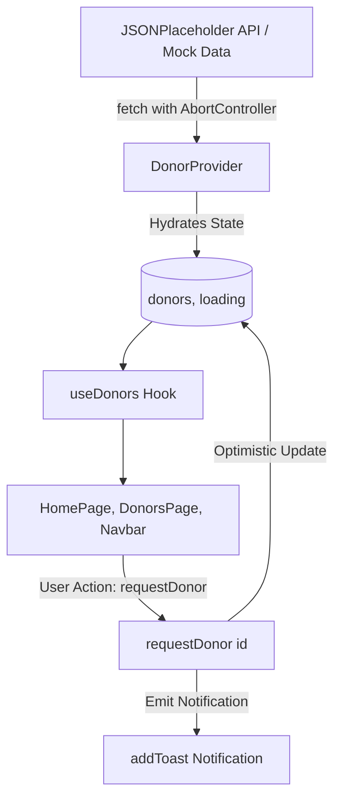

# State Management & Reactive Data Layer

HEMA implements lightweight, high-performance state management using native React 19 Context, eliminating unnecessary third-party state library dependencies.

---

## 📦 State Architecture



---

## 🔧 Context API Specification

### 1. `DonorProvider` (`src/context/DonorContext.jsx`)
Wraps the application in `App.jsx` to provide global access to donor data.
- **Lifecycle Mount**: Initiates an HTTP request to populate donor profiles.
- **Data Augmentation**: Adds randomized blood groups, availability flags, and donation counts.
- **Cleanup**: Aborts pending requests on unmount via `controller.abort()`.

### 2. `useDonors` Hook (`src/context/useDonors.js`)
A custom hook that validates that consumption occurs within a `DonorProvider`:
```javascript
export function useDonors() {
  const context = useContext(DonorContext);
  if (!context) {
    throw new Error("useDonors must be used within a DonorProvider");
  }
  return context;
}
```

### 3. Exported Values
- **`donors`** (`Array<Donor>`): Array of all donor entities.
- **`loading`** (`boolean`): Indicates initial data fetching status.
- **`requestDonor(id)`** (`function`): Dispatches an optimistic request update and emits a confirmation toast.
