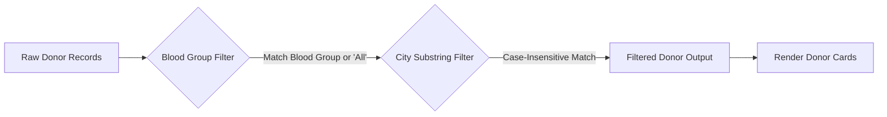

# Geolocation & Search Pipeline

HEMA includes a fast, responsive search and filtering pipeline capable of instantly refining hundreds of donor profiles.

---

## 🔍 Search Pipeline Architecture



---

## ⚙️ Filter Implementation Details

The filtering logic executes client-side with $O(n)$ complexity:

```javascript
const filteredDonors = donors.filter((donor) => {
  const matchesGroup = selectedGroup === "All" || donor.bloodGroup === selectedGroup;
  const matchesCity = cityQuery.trim() === "" ||
    donor.city.toLowerCase().includes(cityQuery.trim().toLowerCase());
  return matchesGroup && matchesCity;
});
```

---

## 🗺️ Planned Geospatial Roadmap

For production deployment with real-world geographical coordinates, HEMA plans to introduce:
1. **Haversine Distance Sorting**: Sorting donors by radial distance (km/miles) from the user's current coordinates.
2. **Radius Filter**: 5 km, 10 km, 25 km, and 50 km distance thresholds.
3. **Privacy-Preserving Geolocation**: Truncating donor coordinates to 2 decimal places (~1.1 km precision) to protect residential privacy.
