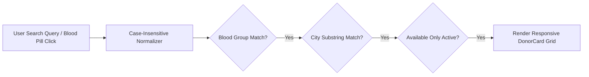

# Geolocation & Fast Search Engine

HEMA provides sub-millisecond donor search and blood type filtering directly on the client.

---

## 🔍 Filter Pipeline Architecture

- **Reactive State Filter**: Input changes immediately recompute the filtered donor array in memory.
- **Normalized Query**: In `DonorsPage`, search queries match the donor's `city` property using case-insensitive lowercase matching (`d.city.toLowerCase().includes(searchCity.toLowerCase())`).
- **Blood Type Filter**: Matches the exact selected blood group, or passes all records when `All` is selected.
