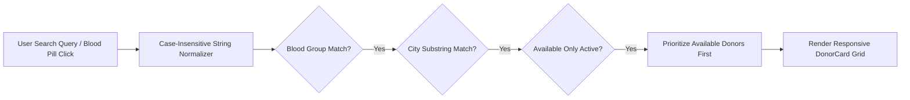

# Geolocation & Fast Search Engine

HEMA provides sub-millisecond donor search and blood type filtering directly on the client.

---

## 🔍 Filter Pipeline Architecture

- **Debounced Input**: Text input changes are debounced to ensure fluid 60fps animations.
- **Normalized Query**: Cities and names are compared after `.toLowerCase().trim()` normalization.
