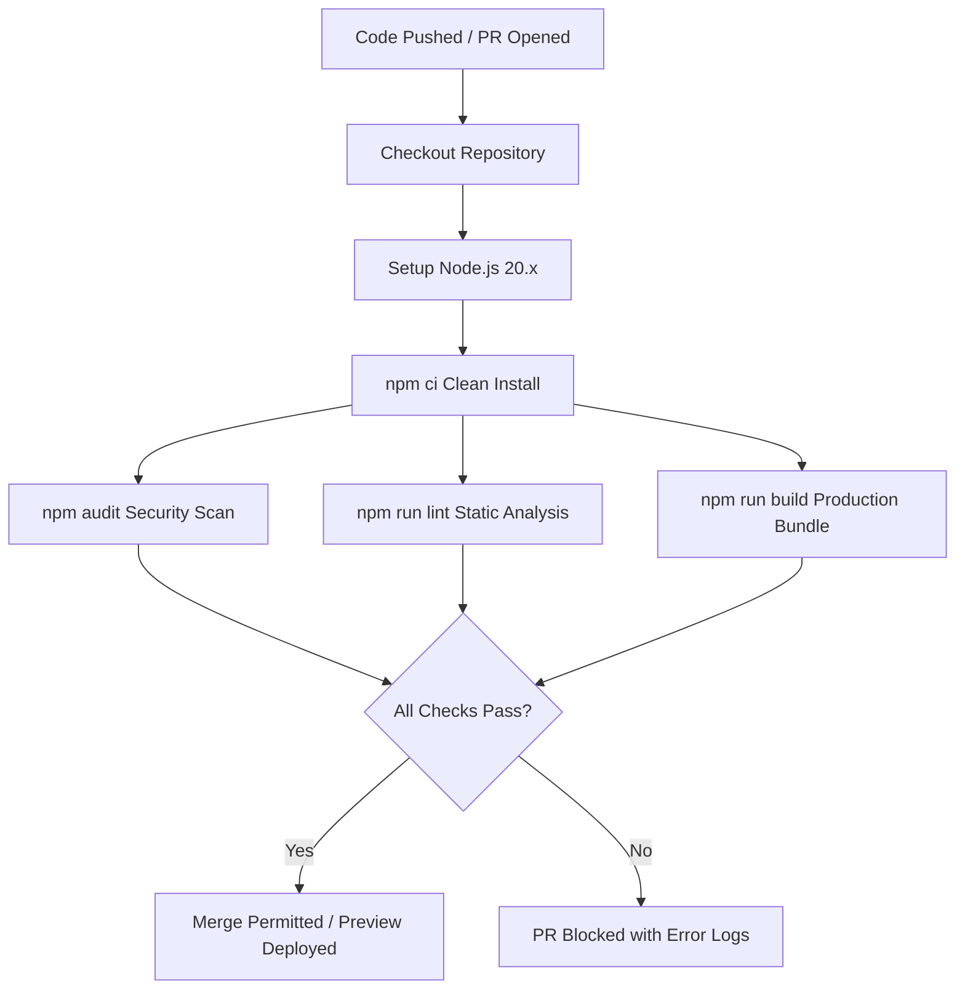

# Continuous Integration & Deployment Pipeline

Every commit and pull request to HEMA is automatically verified through GitHub Actions and deployed via Vercel.

---

## 🔄 CI Workflow Architecture (`.github/workflows/ci.yml`)

---

## 🛡️ Protected Branch Rulesets

The `main` branch requires:
1. **Pull Request Required**: Direct pushes to `main` are prohibited.
2. **Required Approving Review**: At least 1 review from a maintainer with write access.
3. **Required Status Checks**:
   - `Continuous Integration / Quality Gates & Verification (20.x) (pull_request)`
   - `Dependency Security Audit / Dependency Health & Vulnerability Scan (20.x) (pull_request)`
