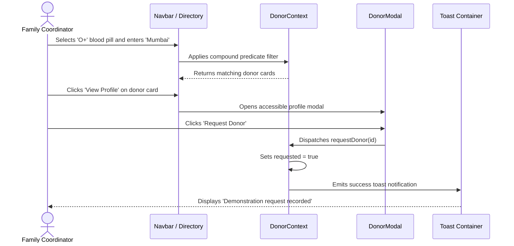

# User Flows & UX Journey

Visual sequence flows and interaction walkthroughs across primary user journeys.

---

## 🔄 Flow A: Emergency Donor Discovery

---

## 🔄 Flow B: Self-Service Donor Registration

1. User navigates to `/become-donor`.
2. Fills in donor credentials: Full Name, City, Phone, Email, and Blood Group.
3. Form validates inputs on submission.
4. Triggers confirmation toast and welcomes the contributor to the network.
