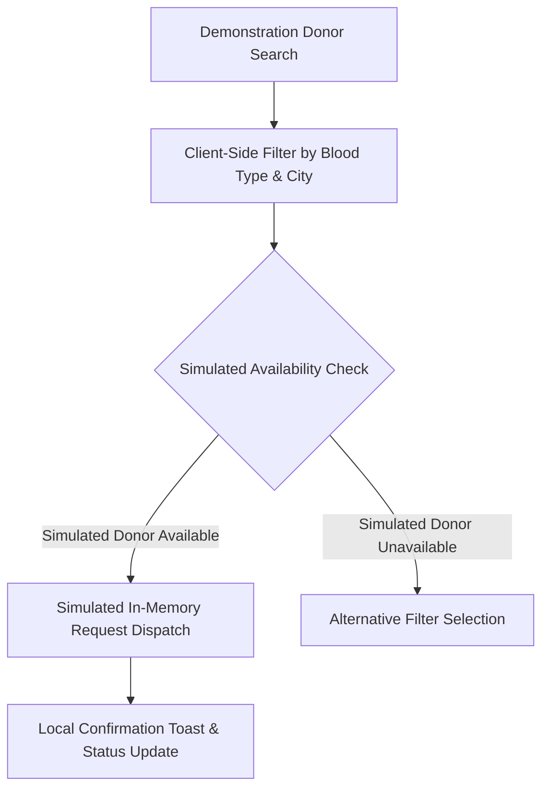

# HEMA - Community Blood Donor Network Wiki

> **Connecting Lifesavers with Those in Critical Need.** An open-source, humanitarian blood donor platform concept built with React 19, Vite 7, React Router v7, and Lucide React.

---

## ⚡ What is HEMA?

HEMA is a proof-of-concept blood donor platform interface designed to explore how modern web interfaces can streamline donor discovery workflows. In this demonstration application, the donor directory presents simulated mock profiles, randomized availability statuses, client-side blood group and city filters, and simulated request dispatch without paywalls or account barriers.

---

## 🎯 The Humanitarian Problem

Emergency blood donation worldwide frequently encounters coordination friction:
- **Fragmented Directories**: Contact information scattered across messaging groups and outdated spreadsheets.
- **Stale Availability**: Potential lifesavers contacted who recently donated or are medically unavailable.
- **Barrier to Entry**: Excessive mandatory account registrations delaying urgent transfusion coordination.
- **Lack of Transparency**: Opacity regarding blood type compatibility and emergency response timing.

## 🩸 Platform Philosophy & Architectural Goals

HEMA demonstrates **Zero-Friction Lifesaving Coordination**:
1. **Barrier-Free Discovery**: Donor discovery requires zero user account creation.
2. **Availability Indicators**: Demonstrates visual status badges distinguishing ready donors from resting donors.
3. **Data Display Minimization**: Contact credentials are kept private and omitted from client-side cards and inspection modals.
4. **Accessible Minimalist UI**: High-contrast, WCAG AA compliant crimson design with fluid wave backdrops.
5. **Open Source & Beginner Friendly**: Welcoming community with micro-issues (5-30 min) and fast reviews.

---

## ✨ Implemented Modules & Capabilities

| Module | Core Capability | Architectural Highlight |
| :--- | :--- | :--- |
| 🧭 **Command Navigation** | 72px vertically centered header & active underline indicator | Fluid CSS transitions & mobile drawer |
| 🌊 **Atmospheric Wave Canvas** | Floating ambient crimson orbs & boundary curves | Keyframe animations & fixed dot-grid |
| 🩸 **Donor Directory** | Simulated mock directory with blood group pills & city search | Client-side reactive filter pipeline |
| 👤 **Interactive Donor Cards** | Initials avatar badges & simulated availability tags | Responsive grid & hover elevation |
| 🪟 **Accessible Donor Modal** | Profile inspection with donation history & availability badge | Keyboard Escape trap & backdrop dismiss |
| 📊 **Network Statistics Bar** | Real-time counts of total donors, active lifesavers & types | Derived reactive state computation |
| ⚡ **Instant Request Pipeline** | One-click donor request updating in-memory state & confirmation toast | Optimistic UI update & toast feedback |
| 📝 **Donor Registration** | Self-contained donor registration form with validation | Instant field validation & benefits column |
| 🗺️ **Process Walkthrough** | 5-step interactive donation timeline & FAQ accordion | Expandable smooth disclosure panels |
| 🔔 **Toast Notification Bus** | Global auto-dismissing notifications (success/info/error) | Lightweight decoupled event bus |
| 🌓 **Dual Theme Engine** | Pure white light mode & deep OLED dark mode (#0C0C0C) | CSS Custom Property tokens system |
| 💀 **Shimmer Skeletons** | Layout-stable animated loading placeholders | Zero Cumulative Layout Shift (CLS) |

---

## 🏗️ Production Technology Stack

| Technology | Role & Purpose | Documentation |
| :--- | :--- | :--- |
| **React 19** | Core declarative UI component model and reactive rendering | [`react.dev`](https://react.dev) |
| **Vite 7** | Sub-50ms HMR bundler and zero-configuration production compiler | [`vite.dev`](https://vite.dev) |
| **React Router v7** | Client-side declarative routing and path resolution | [`reactrouter.com`](https://reactrouter.com) |
| **Lucide React** | Cohesive, featherweight SVG icon system | [`lucide.dev`](https://lucide.dev) |

---

## 🧭 Navigation & Chapters

Explore the full documentation chapters in this wiki:
- [01. Product Overview & Vision](01-Product-Overview)
- [02. Platform Features](02-Features)
- [03. Architecture & Data Flow](03-Architecture)
- [04. Component Catalog](04-Component-Catalog)
- [05. Domain Model & Blood Matrix](05-Domain-Model)
- [06. State Management](06-State-Management)
- [07. Security & Privacy](07-Security-and-Privacy)
- [08. Geolocation & Search](08-Geolocation-and-Search)
- [09. Design System & Tokens](09-Design-System)
- [10. Accessibility & WCAG](10-Accessibility)
- [11. Local Development Guide](11-Development)
- [12. Testing & QA Matrix](12-Testing-and-QA)
- [13. CI/CD Workflows](13-CI-CD)
- [14. Production Deployment](14-Deployment)
- [15. Open Source Contributing](15-Contributing)
- [16. Good First Issues](16-Good-First-Issues)
- [17. Code of Conduct](17-Code-of-Conduct)
- [18. Project Roadmap](18-Roadmap)
- [19. Performance Optimization](19-Performance)
- [20. Troubleshooting Guide](20-Troubleshooting)
- [21. Frequently Asked Questions](21-FAQ)
- [22. Internationalization](22-Internationalization)
- [23. User Flows & UX Journey](23-User-Flows-and-UX)
- [24. Maintainer Runbook](24-Maintainer-Runbook)
