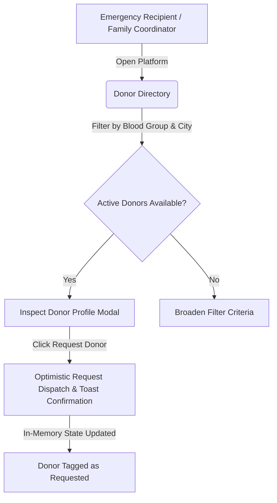

# HEMA - Community Blood Donor Network Wiki

> **Connecting Lifesavers with Those in Critical Need.** An open-source, humanitarian blood donor platform concept engineered with React 19, Vite 7, React Router v7, and Lucide React.

---

## ⚡ What is HEMA?

HEMA is an open-source humanitarian software platform designed to explore how modern client-side web interfaces can streamline the discovery and coordination of volunteer blood donors. By removing mandatory registration barriers, providing instant client-side blood group and city filters, and maintaining strict privacy boundaries over donor contact data, HEMA demonstrates a zero-friction paradigm for community-driven lifesaving networks.

---

## 🎯 The Humanitarian Problem

Emergency blood donation worldwide frequently encounters coordination friction:
- **Fragmented Directories**: Contact information scattered across chat groups, private lists, and outdated spreadsheets.
- **Stale Availability**: Potential lifesavers contacted who recently donated, relocated, or are medically deferred.
- **Account Barriers**: Mandatory sign-up flows that introduce life-threatening latency during urgent medical emergencies.
- **Lack of Transparency**: Opacity regarding blood type compatibility and emergency response timing.

---

## 🩸 Platform Philosophy & Architectural Principles

HEMA demonstrates **Zero-Friction Lifesaving Coordination**:
1. **Barrier-Free Discovery**: Donor discovery requires zero account creation or authentication gates.
2. **Availability Indicators**: Visual status badges distinguish immediately available donors from resting donors.
3. **Data Display Minimization**: Direct contact credentials (phone numbers and emails) are omitted from client-side cards and modal displays to safeguard donor privacy.
4. **Accessible Minimalist UI**: High-contrast, WCAG 2.1 AA compliant crimson design with fluid atmospheric wave backdrops.
5. **Open Source & Beginner Friendly**: Welcoming community with micro-issues (5-20 min), comprehensive documentation, and fast maintainer reviews.

---

## ✨ Implemented Modules & Capabilities

| Module | Core Capability | Architectural Implementation |
| :--- | :--- | :--- |
| 🧭 **Command Navigation** | 72px vertically centered header with route indicators & mobile drawer | Fluid CSS transitions, responsive breakpoint at 768px |
| 🌊 **Atmospheric Wave Canvas** | Floating ambient crimson orbs and animated organic boundary curves | Hardware-accelerated CSS keyframes, zero JS runtime overhead |
| 🩸 **Donor Directory** | Reactive filter pipeline supporting 8 blood groups and live city search | $O(n)$ client-side multi-predicate filter algorithm |
| 👤 **Interactive Donor Cards** | Avatar badges, simulated availability tags, and donation history | Responsive CSS grid with smooth elevation transitions |
| 🪟 **Accessible Profile Modal** | Deep profile inspection dialog with donation counts and location | Keyboard Escape trap, backdrop dismiss, ARIA dialog roles |
| 📊 **Network Statistics Bar** | Real-time counts of total donors, active lifesavers, and blood types | Derived reactive state computation |
| ⚡ **Instant Request Pipeline** | One-click simulated donor request with confirmation toast feedback | Optimistic in-memory state update via React Context |
| 📝 **Donor Registration** | Self-service registration form with instant client-side validation | Controlled form inputs with blood group picker |
| 🗺️ **Process Walkthrough** | 5-step interactive donation timeline and FAQ accordion | Smooth CSS disclosures and accessible tap targets |
| 🔔 **Toast Notification Bus** | Auto-dismissing global notification toasts (success, info, error) | Decoupled lightweight event-driven notification queue |
| 🌓 **Dual Theme Engine** | Pure white light mode and deep OLED dark mode (#0C0C0C) | CSS Custom Property tokens with instant localStorage persistence |
| 💀 **Shimmer Skeletons** | Layout-stable animated loading placeholders | Zero Cumulative Layout Shift (CLS = 0) |

---

## 🏗️ Production Technology Stack

| Layer | Technology | Version | Purpose & Rationale |
| :--- | :--- | :--- | :--- |
| **UI Framework** | React | `^19.0.0` | Modern concurrent rendering, hooks, and clean component architecture |
| **Build Tooling** | Vite | `^7.3.0` | Sub-50ms Hot Module Replacement (HMR) and optimized rollup production bundles |
| **Routing** | React Router DOM | `^7.3.0` | Declarative client-side Single Page Application routing with scroll restoration |
| **Iconography** | Lucide React | `^1.16.0` | Featherweight, accessible, tree-shakeable SVG icon system |
| **Styling** | Native CSS Tokens | CSS3 | Custom property tokens for zero-runtime theme transitions |
| **Deployment** | Vercel Edge | Global | Instant worldwide CDN delivery with SPA rewrites |

---

## 📚 Complete Documentation Index

Explore the exhaustive documentation chapters in this wiki:

### 🏠 Start Here
- **[01. Product Overview](01-Product-Overview)**: Mission statement, humanitarian problem, user personas, and core value proposition.
- **[02. Features Catalog](02-Features)**: Comprehensive breakdown of every feature, component, and interaction.
- **[03. System Architecture](03-Architecture)**: High-level architectural diagrams, data flows, and layer responsibilities.
- **[09. Design System & Tokens](09-Design-System)**: Complete design tokens, color palette, typography scale, and WCAG AA contrast specs.

### 🩸 Under the Hood
- **[04. Codebase Tour](04-Codebase-Tour)**: File-by-file walkthrough of `src/`, exports, hooks, and component hierarchy.
- **[05. Domain Model & Blood Matrix](05-Domain-Model)**: Blood compatibility rules, Rh factors, universal donors, and TypeScript entities.
- **[06. State Management](06-State-Management)**: React 19 Context API, `useDonors` hook, asynchronous hydration, and optimistic updates.
- **[07. Security & Privacy](07-Security-and-Privacy)**: Privacy-by-design, PII minimization, contact masking, and Content Security Policy.
- **[08. Geolocation & Search](08-Geolocation-and-Search)**: Search algorithms, multi-predicate filtering, and future radius calculation.
- **[10. Atmospheric Wave Engine](10-Atmospheric-Wave-Engine)**: Pure CSS keyframe physics, radial gradient orbs, and reduced-motion support.

### 🛠️ Developer Guides
- **[11. Local Development](11-Development)**: Prerequisites, environment setup, Vite dev server, and Docker devcontainer instructions.
- **[12. Testing & QA Matrix](12-Testing-and-QA)**: Static analysis, accessibility audits, manual test matrices, and browser testing.
- **[13. CI/CD Workflows](13-CI-CD)**: GitHub Actions automation, dependency audits, build verification, and deployment pipelines.
- **[14. Production Deployment](14-Deployment)**: Vercel edge deployment, SPA route rewrites (`vercel.json`), and caching policies.
- **[20. Troubleshooting Guide](20-Troubleshooting)**: Common development errors, port conflicts, Node.js version fixes, and solutions.
- **[22. Performance Optimization](22-Performance-Optimization)**: Core Web Vitals (LCP, INP, CLS), CSS containment, and bundle budgets.

### 🌱 Community & Governance
- **[15. Open Source Contributing](15-Contributing)**: Forking, branching conventions, conventional commits, and pull request guidelines.
- **[16. Contributor Journey](16-Contributor-Journey)**: First-time contributor roadmap, micro-issues, and 48-hour maintainer reviews.
- **[17. GitHub Community](17-GitHub-Community)**: Community discussions, issue templates, labeling taxonomy, and Code of Conduct.
- **[18. Project Roadmap](18-Roadmap)**: Strategic milestones from demonstration MVP to hospital integration.
- **[19. Releases & Changelog](19-Releases)**: Semantic Versioning standards and historical release logs.
- **[21. Frequently Asked Questions](21-FAQ)**: Comprehensive FAQ covering medical, technical, and open-source topics.
- **[23. User Flows & UX Journey](23-User-Flows-and-UX)**: End-to-end user journeys with sequence diagrams and UI states.
- **[24. Maintainer Runbook](24-Maintainer-Runbook)**: Day-to-day triage, PR reviews, ruleset configuration, and release automation.
