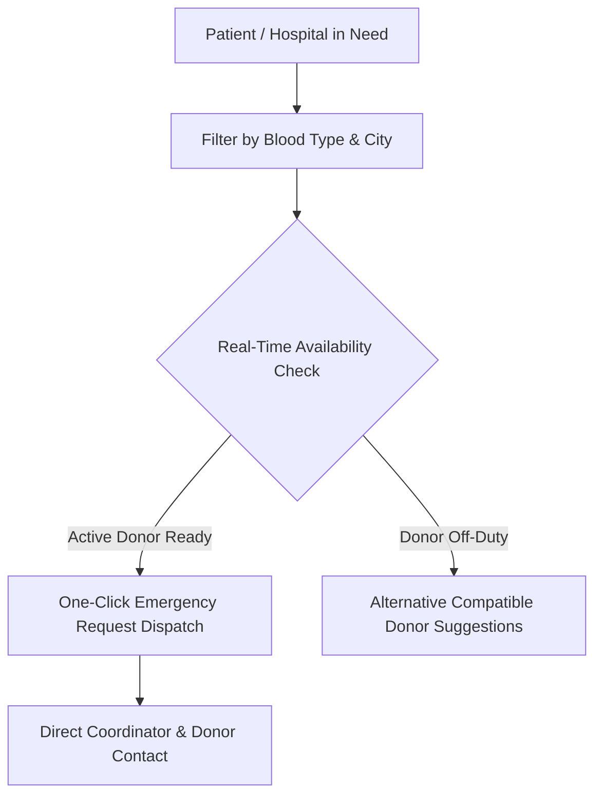
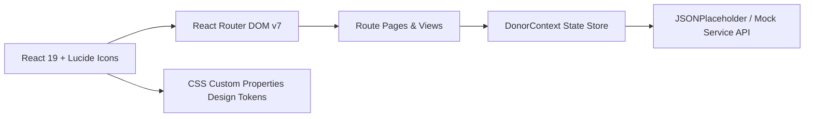

# HEMA - Community Blood Donor Network Wiki

> **Connecting Lifesavers with Those in Critical Need.** An open-source, humanitarian blood donor platform built with React 19, Vite 7, React Router v7, and Lucide React.

---

## ⚡ What is HEMA?

HEMA is a unified, real-time blood donor network platform designed to eliminate delays in emergency medical blood matching. It coordinates blood type compatibility, verified geolocation searching, real-time availability badges, accessible donor profile inspection, and one-click contact requests without paywalls or registration barriers.

---

## 🎯 The Problem

Emergency blood donation worldwide suffers from critical coordination friction:
- **Fragmented Directories**: Contact information scattered across messaging groups and outdated spreadsheets.
- **Stale Availability**: Potential lifesavers contacted who recently donated or are medically unavailable.
- **Barrier to Entry**: Excessive mandatory account registrations delaying urgent transfusion coordination.
- **Lack of Transparency**: Opacity regarding blood type compatibility and emergency response timing.

## 🩸 The Solution & Core Philosophy

HEMA introduces **Zero-Friction Lifesaving Coordination**:
1. **Immediate Contact Dispatch**: Emergency requests require zero user account creation.
2. **Temporal Availability**: Real-time status indicators distinguish active volunteers from resting donors.
3. **Strict Privacy Boundaries**: Contact info is protected and shared only upon confirmed mutual request.
4. **Accessible Minimalist UI**: High-contrast, WCAG AA compliant crimson design with fluid wave backdrops.
5. **Open Source & Beginner Friendly**: Welcoming community with micro-issues (5-30 min) and fast reviews.

---

## ✨ Implemented Modules & Capabilities

| Module | Core Capability | Architectural Highlight |
| :--- | :--- | :--- |
| 🧭 **Command Navigation** | 72px vertically centered header & active underline indicator | Fluid CSS transitions & mobile drawer |
| 🌊 **Atmospheric Wave Canvas** | Floating ambient crimson orbs & boundary curves | Keyframe animations & fixed dot-grid |
| 🩸 **Live Donor Directory** | Instant blood group pills & case-insensitive city search | Debounced real-time filter pipeline |
| 👤 **Interactive Donor Cards** | Initials avatar badges & live availability tags | Responsive grid & hover elevation |
| 🪟 **Accessible Donor Modal** | Complete donor profile inspection & contact credentials | Keyboard Escape trap & backdrop dismiss |
| 📊 **Network Statistics Bar** | Real-time counts of total donors, active lifesavers & types | Derived reactive state computation |
| ⚡ **Instant Request Pipeline** | One-click emergency contact notification | Optimistic UI & session persistence |
| 📝 **Donor Registration** | Self-contained donor registration form with validation | Instant field validation & benefits column |
| 🗺️ **Process Walkthrough** | 5-step interactive donation timeline & FAQ accordion | Expandable smooth disclosure panels |
| 🔔 **Toast Notification Bus** | Global auto-dismissing notifications (success/info/error) | Lightweight decoupled event bus |
| 🌓 **Dual Theme Engine** | Pure white light mode & deep OLED dark mode (#0C0C0C) | CSS Custom Property tokens system |
| 💀 **Shimmer Skeletons** | Layout-stable animated loading placeholders | Zero Cumulative Layout Shift (CLS) |

---

## 🏗️ Production Technology Stack

- **Frontend Library**: React 19 (Hooks, Concurrent Rendering, Context)
- **Build System**: Vite 7 (Hot Module Replacement, Rollup Bundling)
- **Routing Engine**: React Router DOM v7 (Declarative Client-Side Routing)
- **Iconography**: Lucide React (Accessible SVG Icon Suite)
- **Typography**: Inter (Variable Font with High X-Height)
- **Design Tokens**: Pure CSS Custom Properties with Light and OLED Dark Palettes

---

## 🚀 Explore the HEMA Wiki

| Section | Description | Link |
| :--- | :--- | :--- |
| **Product Overview** | Humanitarian mission, personas, and emergency workflows | [Product Overview](01-Product-Overview) |
| **Features & Subsystems** | Detailed breakdown of all 12 core platform modules | [Features & Subsystems](02-Features) |
| **System Architecture** | Component hierarchy, routing tree, and data flow | [System Architecture](03-Architecture) |
| **Design System** | Crimson palette, atmospheric wave orbs, and tokens | [Design System](09-Design-System) |
| **Codebase Tour** | File layout, component directory, and naming rules | [Codebase Tour](04-Codebase-Tour) |
| **Domain Model** | Donor entity schema and blood compatibility rules | [Domain Model](05-Domain-Model) |
| **State Management** | DonorContext, useDonors hook, and optimistic state | [State Management](06-State-Management) |
| **Security & Privacy** | Donor privacy protection and contact credential masking | [Security & Privacy](07-Security-and-Privacy) |
| **Development Guide** | Local clone, npm commands, and debugging instructions | [Development Guide](11-Development) |
| **Testing & QA Matrix** | Quality gates, ESLint rules, and build validation | [Testing & QA Matrix](12-Testing-and-QA) |
| **CI/CD Pipeline** | GitHub Actions workflows and branch ruleset protection | [CI/CD Pipeline](13-CI-CD) |
| **Contributing Guide** | Beginner friendly quick start, micro-issues, and PR steps | [Contributing Guide](15-Contributing) |
| **Project Roadmap** | Past completed milestones and upcoming feature roadmap | [Project Roadmap](18-Roadmap) |
| **Frequently Asked Questions**| Common donor, recipient, and contributor questions | [FAQ](21-FAQ) |
